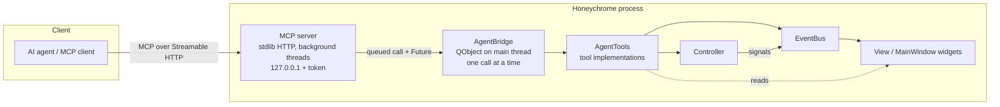

# Tech design: controlling Honeychrome from an AI agent

Status: draft for discussion
Branch: `design/agent-control`

## 1. Summary

Let a user drive the running Honeychrome window in natural language through an AI
agent (VS Code Copilot, Claude Desktop, or any other MCP client). Honeychrome runs
a small Model Context Protocol (MCP) server inside the app. The agent calls tools
such as "load sample", "draw a gate" and "get statistics", and every change appears
in the open window just as if the user had clicked it.

Honeychrome does not parse natural language itself. The agent turns the request
into tool calls; Honeychrome only exposes a safe, well-defined set of tools.

## 2. Goals and non-goals

Goals

- An agent can inspect and change the experiment that is open in the GUI, and the
  GUI stays in sync (plots, ROIs, gating tree, statistics, sample selection).
- Tools follow the same code paths as the user's clicks, so behaviour, autosave
  and per-sample custom gates work unchanged.
- Off by default, local only, and unable to drive the instrument.
- Small footprint: one new package, a handful of small changes to existing files.

Non-goals (for the first version)

- Instrument control (acquisition start/stop, gains). Excluded on purpose.
- Plugin tabs (AutoSpectral, DR/clustering, automated gating, 3D plot). Their
  logic lives in the widgets and must be moved out first; see Phase 3.
- A chat panel inside Honeychrome. The agent's own client is the chat UI.
- Running without the GUI. A headless MCP server is possible later, but it is not
  what this design is about.

## 3. User experience

1. The user ticks **Edit > App Configuration > Let AI agents control Honeychrome**
   and presses OK. The status bar shows `Agent control: on (http://127.0.0.1:<port>/mcp)`,
   and **Copy client settings (mcp.json)** in the same dialog copies the client
   config with its token.
2. The user pastes the settings into their MCP client, opens an experiment in
   Honeychrome and asks, for example:

   > Open sample "Tube_003", draw a cells gate on FSC-A vs SSC-A that excludes
   > debris, then a singlets gate on FSC-A vs FSC-H inside it, and tell me the
   > percentage of singlets.

3. The agent calls `get_state`, `list_samples`, `load_sample`, `get_plot_image`,
   `summarise_plot`, `create_gate` (twice) and `get_statistics`. The user sees the
   sample being selected, the ROIs appearing on the plots, the gating tree
   updating, and gets the answer in the chat.
4. While the agent is working, the status bar shows `Agent: <tool name>`. Changes
   the agent makes are autosaved like the user's. Before the first change in a
   session, a backup copy of the `.kit` is written.

## 4. Architecture



Honeychrome is MVC with a signal bus. Widgets emit on `EventBus`, `view.py` wires
those signals to controller methods, and the controller emits back so that the
widgets refresh ([view.py](../src/honeychrome/view.py), `_connect_signals`). The
agent layer plugs into the same bus, so the widgets need no changes.

### 4.1 New modules

All agent code lives in a new package, `src/honeychrome/agent_control/`. Only
`__init__.py` is imported at startup; the rest is imported when the server starts.

| Module | Role |
|---|---|
| `__init__.py` | `AgentControl`: settings (enabled, port, token), start/stop, status-bar indicator |
| `server.py` | The MCP server on a background thread: JSON-RPC handling, tool list, argument checks, token and origin checks |
| `bridge.py` | `AgentBridge(QObject)`: runs a tool on the Qt main thread, one at a time, and captures the messages Honeychrome shows meanwhile |
| `tools.py` | One function per tool; the only code that touches the controller, bus and widgets |
| `coordinates.py` | Converts gate coordinates between data units and plot coordinates, and builds or reshapes gates as the plot widget does |

## 5. Detailed design

### 5.1 MCP server (`server.py`)

- A minimal MCP server written with the standard library (`http.server`), using
  the **Streamable HTTP** transport in its simplest form: every request is a
  POST answered with one JSON response (no SSE stream, no sessions). It serves
  tools only (`initialize`, `ping`, `tools/list`, `tools/call`), so the official
  `mcp` SDK, with its `pydantic`/`starlette`/`uvicorn` dependencies and
  PyInstaller hooks, is not needed. It binds to `127.0.0.1` on a configurable
  port (default 8765).
- Runs on daemon threads (`ThreadingHTTPServer`). `main()` starts it after the
  `View` exists, when enabled, and stops it on quit.
- Each request must carry `Authorization: Bearer <token>`. The token is random
  (`secrets.token_urlsafe(32)`), kept in QSettings, and can be regenerated from
  App Configuration. Requests with a non-local browser `Origin` are refused.
- Tool handlers do no work themselves: they check the arguments against the
  tool's schema (types, enums, required, no extras) and call
  `bridge.call(tool_name, args)`, which waits for the result with a timeout.
  Argument and tool errors are returned as tool results with `isError: true`, so
  the agent can correct itself; an unknown tool is a JSON-RPC error.

Why not stdio: stdio means the client starts the server process. Here the server
must live inside the GUI process that the user already has open. A local HTTP
endpoint is the standard MCP way to do this.

### 5.2 Main-thread bridge (`bridge.py`)

Qt widgets and most controller state may only be touched on the main thread. The
server thread therefore never calls the controller directly.

```python
class AgentBridge(QObject):
    _requested = Signal(object)          # a _Call, delivered by a queued connection

    def call(self, name, timeout, **kwargs):     # server thread
        job = _Call(name, kwargs, concurrent.futures.Future())
        self._requested.emit(job)
        return job.future.result(timeout)

    @Slot(object)
    def _run(self, job):                         # main thread
        ...  # see below
```

Rules:

1. **One agent call at a time.** Controller methods decorated with
   `with_busy_cursor` run in a worker thread while the main thread spins a nested
   `QEventLoop` ([busy_cursor.py](../src/honeychrome/view_components/busy_cursor.py)).
   That nested loop would deliver the next queued agent call in the middle of the
   current one. `_run` holds a re-entrancy flag; a second call that arrives while
   the first is running is queued and started when the first finishes.
2. **Respect the job gate.** If `controller.job_gate.is_held()` (DR, statistics,
   AF extraction, noise fit, export, and so on), write tools fail at once with
   `busy_text()` instead of waiting. Read tools still run.
3. **Errors become tool errors.** Exceptions are logged with `logger.exception`
   and returned to the agent as an MCP tool error with a short message. They are
   never swallowed.
4. **Timeout.** The default is 60 s, longer for `refresh_unmixing`. When it
   expires, the agent gets an error; the main-thread work is not killed, and the
   next call waits until it finishes.

### 5.3 Tools follow the user's path (`tools.py`)

Each write tool does what the matching click does, in this order of preference:

1. **Drive the widget the user would use** when the widget does extra work. For
   example, switching tabs calls `main_window.tabs.setCurrentIndex(i)`, which runs
   `on_tab_changed` and emits `modeChangeRequested`
   ([main_window.py](../src/honeychrome/view_components/main_window.py), `on_tab_changed`).
2. **Emit the existing bus signal** when the click is just a signal, for example
   `selectSample` and `loadSampleRequested` to load a sample.
3. **Call the controller and emit the sync signals** when the GUI path lives inside
   a widget and cannot be reused (gate creation, §5.4). This follows the existing
   precedent in [spectral_controller.py](../src/honeychrome/controller_components/spectral_controller.py)
   (around lines 290-330 and 712), which adds gates programmatically and emits
   `showNewPlot`, `changedGatingHierarchy` and `updateRois` so that the ROIs appear.

Tools never keep references to widgets between calls: `MainWindow` is rebuilt
whenever an experiment is opened (`load_main_window_with_experiment_and_template`).
They look the widget up from `view.main_window` each time and check `isValid`.

Untrusted text: sample names, FCS keywords, gate names and file contents are
returned to the agent as data. Tool descriptions remind the agent that this text
is not an instruction (prompt-injection hygiene).

### 5.4 Gates

The GUI creates a gate inside the plot widget: it builds the FlowKit gate, adds
the ROI and emits `updateSourceChildGates` and `changedGatingHierarchy`
([cytometry_plot_widget.py](../src/honeychrome/view_components/cytometry_plot_widget.py),
`create_polygon_gate` and the other `new_*_gate` methods). Those methods are tied
to mouse interaction, so the agent path is:

1. Resolve the target plot `(scope, plot_index)` and check that it is a `hist2d`
   or `hist1d` plot, and that the gate type is valid for it.
2. Convert the agent's coordinates from **data units** (what it reads in
   `summarise_plot`) to plot coordinates using the channel's transformation
   (`coordinates.py`, the inverse of `define_rectangle_gate` /
   `define_polygon_gate`).
3. Call `controller.create_or_update_gate(...)`. This exists already, supports
   rectangle, polygon, ellipse, range and quad gates, and is currently used only
   by tests (its docstring says "no longer used by gui").
4. Append the gate to the plot's `child_gates`, then emit
   `updateSourceChildGates(scope, name)`, `changedGatingHierarchy(scope, name)` and
   `updateRois(scope, plot_index)`. Autosave follows from these signals.

Gate names must be unique within the scope. If a gate with the same name exists,
`create_gate` fails unless `replace=true` is given. Deleting a gate removes its
descendants, so `delete_gate` needs confirmation (§6).

If a sample has a custom version of the gate, `update_gate` changes that
version, as dragging the ROI does; otherwise it changes the gate shared by all
samples. `customise_gate` and `revert_gate` map one-to-one to the existing
`customiseGateRequested` and `revertGateRequested` signals.

### 5.5 Seeing the data

The agent cannot place gates well blind. Two observation tools give it eyes:

- `get_plot_image(scope, plot_index)` grabs the plot widget
  (`QWidget.grab()` → PNG) and returns it as MCP image content, with the axis
  ranges in data units.
- `summarise_plot(scope, plot_index)` returns a text summary computed from the
  events in the plot's source gate: event count, percentiles per axis, and the
  top density peaks with their approximate extents in data units. Models that
  cannot read images can use this.

The agent proposes a gate, draws it, then checks it with `get_statistics` and
`get_plot_image`. Gates drawn by an agent are a suggestion: the user is
expected to look at them.

### 5.6 Pop-ups and dialogs

- `View.popup_message` and `View.warning_message` open a modal `QMessageBox`
  ([view.py](../src/honeychrome/view.py)). While an agent call is running, `messages.py`
  diverts them: the text goes into the tool result instead of a dialog. Outside
  agent calls nothing changes.
- The text is captured when `popupMessage`/`warningMessage` is emitted, not when
  the dialog opens: `warning_message` re-queues itself while a busy-cursor job
  runs (up to about 10 s), so the dialog can open after the tool call has
  returned.
- Tools never open file dialogs. They take paths as arguments, and the paths are
  checked (§6).
- Any other modal dialog reached from a tool's code path is a bug in the tool;
  tests use the existing `qt-testing` guards that fail on unexpected pop-ups.

### 5.7 Tool set (implemented)

Read tools

| Tool | Returns | Source |
|---|---|---|
| `get_state` | experiment path, tabs and current tab/scope, current sample, job-gate holder | controller, `job_gate` |
| `list_experiments` | recent `.kit` files and those in `~/Experiments` | recent files QSettings |
| `list_samples(filter?)` | sample keys and names, events, controls, unstained, beads | `experiment.samples` |
| `list_channels(scope)` | PnN, display labels, transform, visible range | `data_for_cytometry_plots_*` |
| `get_gating_tree(scope)` | gate names, types, parents, geometry in data units, plots, custom flag | gating strategy |
| `list_plots(scope)` | index, type, channels, source gate, child gates | `data_for_cytometry_plots_*['plots']` |
| `get_statistics(scope)` | counts and percentages (of parent, of total) | `data_for_cytometry_plots_*['statistics']` |
| `get_plot_image(scope, plot_index)` | PNG + axis ranges | plot widget |
| `summarise_plot(scope, plot_index)` | percentiles and density peaks (§5.5) | event data + gate membership |
| `get_spectral_model` | controls, unmixing method, condition number | `experiment.process` |

Write tools

| Tool | Does | Path |
|---|---|---|
| `open_experiment(path)` | opens a `.kit` from `list_experiments` | `loadExpRequested` |
| `switch_tab(name)` | shows Raw Data / Unmixed Data / Spectral Process / ... | `tabs.setCurrentIndex` |
| `load_sample(sample)` | selects and loads a sample | `selectSample` (+ `loadSampleRequested`) |
| `add_plot(scope, x, y?, source_gate?)` | new 2D or 1D plot | `newPlotRequested` + `plotChangeRequested` |
| `delete_plot(scope, plot_index)` | removes a plot and its gates (confirmation if it has gates) | grid `proceed_to_delete_plot` |
| `set_plot_source_gate(scope, plot_index, gate)` | changes a plot's source gate | plot widget `set_source_gate` |
| `set_plot_channels(scope, plot_index, x, y?)` | changes channels of a plot without gates | `plotChangeRequested` |
| `set_axis_transform(scope, channel, transform)` | linear / logicle / log | `axisTransformed` |
| `fit_axes_to_data(scope, plot_index)` | as the plot menu | plot widget |
| `create_gate(scope, plot_index, gate_type, coordinates, name?, units?)` | §5.4 | gating + sync signals |
| `update_gate(scope, gate_name, coordinates, units?)` | moves or reshapes a gate | same |
| `delete_gate(scope, gate_name)` | removes a gate, children move up (confirmation) | gating + sync signals |
| `customise_gate`, `revert_gate` | per-sample custom gate | existing bus signals |
| `refresh_unmixing()` | recalculates the unmixing | `spectralModelUpdated` |
| `save_experiment()` | saves the `.kit` | `saveExpRequested` |

Still to do: exporting statistics, the Simple Stats comparison across samples,
editing the spectral model, and the plugin tabs.

Every tool has a JSON schema with enums for scope (`raw`, `unmixed`) and gate
type, so that the agent gets argument errors before anything runs.

## 6. Safety and security

| Risk | Mitigation |
|---|---|
| Another local process or a web page calls the server | Bind to 127.0.0.1 only; bearer token required; reject requests with a browser `Origin` header (DNS rebinding) |
| The agent drives the instrument | No acquisition or gain tools exist. The bridge also refuses calls during live acquisition |
| The agent destroys work | Backup `<name>.kit.agent-backup` before the first write of each session; `delete_gate` and other destructive tools need confirmation (MCP elicitation if the client supports it, otherwise a Qt yes/no prompt in Honeychrome) |
| Reading or writing arbitrary files | Paths must resolve inside the open experiment folder or `~/Experiments/`; no tool takes a free path to write |
| Prompt injection through sample names or FCS keywords | Returned as data only; tool descriptions say so; no tool executes text from the data |
| The feature is on without the user knowing | Off by default; status-bar indicator while listening; every tool call is logged with `logger.info` (name and arguments, never the token) |

## 7. Working alongside the user

- Agent calls are serialised (§5.2), and long controller work already shows the
  busy cursor, so the user and the agent rarely change the same thing at once.
- Tools read state fresh on every call, so edits the user makes between agent
  calls are seen by the agent.
- If the user opens another experiment, tools fail with "experiment changed"
  until the agent calls `get_state` again (each response includes the experiment
  path and the agent passes it back as an optional precondition).

## 8. Packaging and configuration

- No new dependency: the server uses only the standard library, so
  `pyproject.toml` and the PyInstaller hooks are unchanged.
- QSettings keys (`app_configuration`): `agent_control_enabled` (bool),
  `agent_control_port` (int), `agent_control_token` (str).

Client configuration (VS Code `mcp.json`, copied by the app):

```json
{
  "servers": {
    "honeychrome": {
      "type": "http",
      "url": "http://127.0.0.1:8765/mcp",
      "headers": { "Authorization": "Bearer <token>" }
    }
  }
}
```

## 9. Testing

- **Tool tests (pytest-qt, offscreen).** Build a small synthetic experiment in a
  temp folder (as the existing UI tests do), open it in a real `View`, and call
  each tool through `AgentBridge`, not the HTTP layer. Check both the model and
  the GUI. For example, after `create_gate`, the gate is in the gating strategy,
  the plot widget has one more ROI with that name, the gating tree shows it, and
  the statistics include it.
- **Mutation check.** Each sync test must fail when the sync signal is removed
  (for example, drop the `updateRois` emit and confirm that the ROI test fails).
- **Bridge tests.** A call from a non-main thread runs on the main thread; two
  overlapping calls run one after the other; a call during a `with_busy_cursor`
  nested loop is not re-entered; the job gate refuses write tools.
- **Server tests.** Start the server on a free port and use the SDK's client to
  list the tools, call `get_state`, and check that a wrong or missing token gets
  a 401 response.
- **Manual end-to-end.** VS Code Copilot against a real experiment, with the
  scenario in §3.

## 10. Phases

| Phase | Scope | Changes outside `agent_control/` |
|---|---|---|
| 0 + 1 (done) | Server, bridge, token, App Configuration section, read and write tools of §5.7, pop-up capture, backup, confirmation | `view.py` (manager, pop-up diversion, indicator), `main.py` (start/stop), `configuration_dialogs.py` (settings) |
| 2 | Statistics export, Simple Stats comparison across samples, spectral model editing | none expected |
| 3 | Plugin tabs | move plugin logic out of widgets first; each plugin can register its own tools through `tab_plugins` |

## 11. Alternatives considered

- **Headless MCP server in a separate process.** Simpler, because it needs no
  thread bridge and shows no pop-ups, but the user does not see anything happen
  and two processes can write the same `.kit`. Kept as a possible later addition
  for batch work. It can reuse `tools.py` with the widget-only tools turned off.
- **Chat panel inside Honeychrome calling an LLM API.** Needs API keys, a model
  choice and a chat UI inside the app, and ties Honeychrome to a provider. MCP
  lets the user bring any agent.
- **GUI automation (pywinauto, accessibility APIs).** Fragile, platform-specific,
  and the agent would still have no access to data or statistics.
- **Letting the agent write Python against `Controller`.** Already possible
  today, and useful for scripting, but it does not drive the open window.

## 12. Open questions

1. Whether to move to the official `mcp` SDK later (SSE streaming, progress
   notifications, elicitation). That would add dependencies and PyInstaller
   hooks; the current tools do not need it.
2. Whether the confirmation for destructive tools should stay a Honeychrome
   dialog (works with every client) rather than MCP elicitation.
3. Whether tools should take gate coordinates in data units only, or also accept
   plot coordinates (0-1) for agents that work from the image. (Implemented:
   both, with `units`.)
4. `load_sample` emits `selectSample`, which selects the row and loads the
   sample; `loadSampleRequested` is emitted only if that did not load it.
