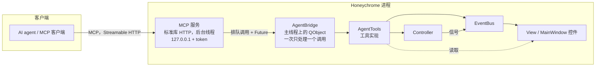

# 技术设计：用 AI Agent 控制 Honeychrome

状态：讨论稿
分支：`design/agent-control`
英文原版：[agent_control.md](agent_control.md)

## 1. 概述

让用户通过 AI agent（VS Code Copilot、Claude Desktop 或其他任何 MCP 客户端）用自然语言操作正在运行的 Honeychrome 窗口。Honeychrome 在程序内运行一个小型 MCP（Model Context Protocol）服务。Agent 调用“加载样本”“画门”“读取统计”等工具，每一步改动都会出现在打开的窗口里，就像用户自己点击一样。

Honeychrome 自己不解析自然语言。把请求翻译成工具调用是 agent 的事，Honeychrome 只提供一组安全、明确的工具。

## 2. 目标与非目标

目标

- Agent 能查看和修改 GUI 中当前打开的实验，界面同步更新（图、ROI、门层级树、统计、样本选择）。
- 工具走和用户点击相同的代码路径，所以现有行为、自动保存、样本自定义门都不受影响。
- 默认关闭，仅限本机访问，不能控制仪器。
- 改动小：新增一个包，现有文件只做少量修改。

非目标（第一版）

- 仪器控制（开始/停止采集、增益）。有意排除。
- 插件标签页（AutoSpectral、DR/聚类、自动圈门、3D 图）。它们的逻辑写在控件里，需要先拆出来，见第 3 阶段。
- Honeychrome 内置聊天面板。Agent 客户端本身就是聊天界面。
- 无界面运行。以后可以做无头 MCP 服务，但不在本设计范围内。

## 3. 用户体验

1. 用户在 **Edit > App Configuration** 中勾选 **Let AI agents control Honeychrome** 并点 OK。状态栏显示 `Agent control: on (http://127.0.0.1:<port>/mcp)`；同一对话框里的 **Copy client settings (mcp.json)** 按钮可复制带 token 的客户端配置。
2. 用户把配置粘贴到 MCP 客户端，在 Honeychrome 里打开实验，然后提出请求，例如：

   > 打开样本 "Tube_003"，在 FSC-A vs SSC-A 上画一个去掉碎片的细胞门，然后在它下面的 FSC-A vs FSC-H 上画单细胞门，告诉我单细胞的百分比。

3. Agent 依次调用 `get_state`、`list_samples`、`load_sample`、`get_plot_image`、`summarise_plot`、两次 `create_gate`、`get_statistics`。用户能看到样本被选中、图上出现 ROI、门层级树更新，并在聊天里得到答案。
4. Agent 工作期间，状态栏显示 `Agent: <工具名>`。Agent 的改动和用户的改动一样会自动保存。每次会话第一次修改前，先备份一份 `.kit`。

## 4. 架构



Honeychrome 是带信号总线的 MVC 结构。控件在 `EventBus` 上发信号，`view.py` 把这些信号接到 controller 方法上，controller 再发信号回来让控件刷新（[view.py](../src/honeychrome/view.py) 的 `_connect_signals`）。Agent 层接入同一条总线，所以控件不需要改。

### 4.1 新增模块

所有 agent 代码放在新包 `src/honeychrome/agent_control/` 里。启动时只导入 `__init__.py`，其余模块在服务启动时才导入。

| 模块 | 职责 |
|---|---|
| `__init__.py` | `AgentControl`：设置（开关、端口、token）、启动/停止、状态栏提示 |
| `server.py` | 后台线程上的 MCP 服务：JSON-RPC 处理、工具列表、参数校验、token 和 Origin 校验 |
| `bridge.py` | `AgentBridge(QObject)`：在 Qt 主线程上逐个执行工具，同时截获期间 Honeychrome 显示的消息 |
| `tools.py` | 每个工具一个函数；只有这里会接触 controller、总线和控件 |
| `coordinates.py` | 在数据单位和图坐标之间转换门坐标，并像图控件那样创建或修改门 |

## 5. 详细设计

### 5.1 MCP 服务（`server.py`）

- 用标准库（`http.server`）写的最小 MCP 服务，采用 **Streamable HTTP** 最简单的形式：每个请求都是 POST，返回一个 JSON 响应（不用 SSE 流，不用会话）。只提供工具（`initialize`、`ping`、`tools/list`、`tools/call`），因此不需要官方 `mcp` SDK 及其 `pydantic`/`starlette`/`uvicorn` 依赖和 PyInstaller hook。绑定 `127.0.0.1`，端口可配置（默认 8765）。
- 运行在守护线程上（`ThreadingHTTPServer`）。启用时由 `main()` 在 `View` 创建后启动，退出时停止。
- 每个请求必须带 `Authorization: Bearer <token>`。Token 随机生成（`secrets.token_urlsafe(32)`），保存在 QSettings，可在 App Configuration 里重新生成。带非本机浏览器 `Origin` 的请求被拒绝。
- 工具处理函数本身不干活：按工具的 schema 校验参数（类型、枚举、必填、不允许多余参数），然后调用 `bridge.call(tool_name, args)`，带超时等待结果。参数错误和工具错误都以 `isError: true` 的工具结果返回，方便 agent 自行修正；未知工具返回 JSON-RPC 错误。

为什么不用 stdio：stdio 意味着由客户端启动服务进程，而这里的服务必须运行在用户已经打开的 GUI 进程里。本地 HTTP 端点是 MCP 处理这种情况的标准做法。

### 5.2 主线程桥接（`bridge.py`）

Qt 控件和大部分 controller 状态只能在主线程操作，所以服务线程从不直接调用 controller。

```python
class AgentBridge(QObject):
    _requested = Signal(object)          # 一个 _Call，通过 queued connection 送达

    def call(self, name, timeout, **kwargs):     # 服务线程
        job = _Call(name, kwargs, concurrent.futures.Future())
        self._requested.emit(job)
        return job.future.result(timeout)

    @Slot(object)
    def _run(self, job):                         # 主线程
        ...  # 见下文
```

规则：

1. **一次只处理一个 agent 调用。** 带 `with_busy_cursor` 装饰的 controller 方法会在工作线程里运行，同时主线程跑一个嵌套的 `QEventLoop`（[busy_cursor.py](../src/honeychrome/view_components/busy_cursor.py)）。这个嵌套循环会在当前调用进行到一半时，把下一个排队的 agent 调用送进来。`_run` 用一个重入标志：第一个调用还在进行时到达的第二个调用先排队，等第一个结束后再开始。
2. **遵守 job gate。** 如果 `controller.job_gate.is_held()`（DR、统计、AF 提取、噪声模型拟合、导出等正在进行），写操作工具立即返回失败并附上 `busy_text()`，不等待。读操作工具照常运行。
3. **异常变成工具错误。** 用 `logger.exception` 记录日志，并以 MCP 工具错误的形式把简短信息返回给 agent，绝不吞掉异常。
4. **超时。** 默认 60 秒，`refresh_unmixing` 更长。超时后 agent 收到错误；主线程上的工作不会被强行终止，下一个调用会等它完成。

### 5.3 工具走用户的路径（`tools.py`）

每个写操作工具都做和对应点击相同的事，优先级如下：

1. **当控件本身还做额外工作时，直接操作用户会用的那个控件。** 例如切换标签页调用 `main_window.tabs.setCurrentIndex(i)`，它会运行 `on_tab_changed` 并发出 `modeChangeRequested`（[main_window.py](../src/honeychrome/view_components/main_window.py) 的 `on_tab_changed`）。
2. **当点击只是发一个信号时，发出现有的总线信号。** 例如加载样本用 `selectSample` 和 `loadSampleRequested`。
3. **当 GUI 的路径写在控件内部、无法复用时，调用 controller 再发出同步信号**（画门，见 §5.4）。这沿用了 [spectral_controller.py](../src/honeychrome/controller_components/spectral_controller.py)（约第 290-330 行和第 712 行）里已有的做法：用代码添加门，然后发出 `showNewPlot`、`changedGatingHierarchy` 和 `updateRois`，让 ROI 显示出来。

工具在两次调用之间不保留控件引用：每次打开实验都会重建 `MainWindow`（`load_main_window_with_experiment_and_template`）。每次调用都从 `view.main_window` 重新查找控件，并检查 `isValid`。

不可信文本：样本名、FCS 关键字、门名和文件内容都作为数据返回给 agent。工具描述会提醒 agent，这些文本不是指令（防提示注入）。

### 5.4 门

GUI 在图控件内部创建门：构建 FlowKit 门、添加 ROI，然后发出 `updateSourceChildGates` 和 `changedGatingHierarchy`（[cytometry_plot_widget.py](../src/honeychrome/view_components/cytometry_plot_widget.py) 中的 `create_polygon_gate` 和其他 `new_*_gate` 方法）。这些方法和鼠标交互绑在一起，所以 agent 的路径是：

1. 确定目标图 `(scope, plot_index)`，检查它是 `hist2d` 或 `hist1d` 图，且门类型适用于它。
2. 用通道的变换把 agent 给出的坐标从**数据单位**（即它在 `summarise_plot` 中读到的单位）转换为图坐标（`coordinates.py`，是 `define_rectangle_gate` / `define_polygon_gate` 的逆运算）。
3. 调用 `controller.create_or_update_gate(...)`。这个方法已经存在，支持矩形、多边形、椭圆、范围门和象限门，目前只有测试在用（其 docstring 写着 “no longer used by gui”）。
4. 把门加入图的 `child_gates`，然后发出 `updateSourceChildGates(scope, name)`、`changedGatingHierarchy(scope, name)` 和 `updateRois(scope, plot_index)`。这些信号会触发自动保存。

门名在同一 scope 内必须唯一。已有同名门时，除非传入 `replace=true`，否则 `create_gate` 失败。删除门会连同其子门一起删除，所以 `delete_gate` 需要确认（§6）。

如果某个样本有该门的自定义版本，`update_gate` 修改的是这个自定义版本（和拖动 ROI 一样）；否则修改所有样本共用的门。`customise_gate` 和 `revert_gate` 一一对应现有的 `customiseGateRequested` 和 `revertGateRequested` 信号。

### 5.5 看到数据

Agent 看不到数据就画不好门。两个观察工具给它“眼睛”：

- `get_plot_image(scope, plot_index)`：截取图控件（`QWidget.grab()` → PNG），以 MCP 图片内容返回，附带数据单位的坐标轴范围。
- `summarise_plot(scope, plot_index)`：根据图的源门内的事件返回文字摘要：事件数、每个轴的分位数、主要密度峰及其在数据单位下的大致范围。不能读图的模型可以用这个。

Agent 先提出一个门并画出来，再用 `get_statistics` 和 `get_plot_image` 检查。Agent 画的门只是建议，用户应当检查。

### 5.6 弹窗和对话框

- `View.popup_message` 和 `View.warning_message` 会弹出模态 `QMessageBox`（[view.py](../src/honeychrome/view.py)）。Agent 调用进行期间，`messages.py` 截获它们：文本放进工具结果，不弹窗。不在 agent 调用期间则一切照旧。
- 文本在 `popupMessage`/`warningMessage` 信号**发出时**截获，而不是在对话框打开时：`warning_message` 在忙碌光标任务运行期间会自己重新排队（最多约 10 秒），所以对话框可能在工具调用返回之后才打开。
- 工具从不打开文件对话框。路径作为参数传入，并经过检查（§6）。
- 工具的代码路径中如果碰到其他模态对话框，就是工具的 bug；测试使用现有 `qt-testing` 中的防护，遇到意外弹窗即失败。

### 5.7 工具集（已实现）

读操作工具

| 工具 | 返回 | 来源 |
|---|---|---|
| `get_state` | 实验路径、标签页和当前标签页/scope、当前样本、job gate 占用者 | controller、`job_gate` |
| `list_experiments` | 最近打开的和 `~/Experiments` 中的 `.kit` 文件 | 最近文件 QSettings |
| `list_samples(filter?)` | 样本键和名称、事件数、对照、未染色、微球 | `experiment.samples` |
| `list_channels(scope)` | PnN、显示标签、变换、可见范围 | `data_for_cytometry_plots_*` |
| `get_gating_tree(scope)` | 门名、类型、父门、数据单位下的几何形状、所在图、是否自定义 | gating strategy |
| `list_plots(scope)` | 序号、类型、通道、源门、子门 | `data_for_cytometry_plots_*['plots']` |
| `get_statistics(scope)` | 计数和百分比（占父门、占总数） | `data_for_cytometry_plots_*['statistics']` |
| `get_plot_image(scope, plot_index)` | PNG + 坐标轴范围 | 图控件 |
| `summarise_plot(scope, plot_index)` | 分位数和密度峰（§5.5） | 事件数据 + 门归属 |
| `get_spectral_model` | 对照、解混方法、条件数 | `experiment.process` |

写操作工具

| 工具 | 作用 | 路径 |
|---|---|---|
| `open_experiment(path)` | 打开 `list_experiments` 中的 `.kit` | `loadExpRequested` |
| `switch_tab(name)` | 切换到 Raw Data / Unmixed Data / Spectral Process / … | `tabs.setCurrentIndex` |
| `load_sample(sample)` | 选中并加载样本 | `selectSample`（必要时 + `loadSampleRequested`） |
| `add_plot(scope, x, y?, source_gate?)` | 新建 2D 或 1D 图 | `newPlotRequested` + `plotChangeRequested` |
| `delete_plot(scope, plot_index)` | 删除图及其上的门（有门时需确认） | grid 的 `proceed_to_delete_plot` |
| `set_plot_source_gate(scope, plot_index, gate)` | 修改图的源门 | 图控件的 `set_source_gate` |
| `set_plot_channels(scope, plot_index, x, y?)` | 修改无门图的通道 | `plotChangeRequested` |
| `set_axis_transform(scope, channel, transform)` | linear / logicle / log | `axisTransformed` |
| `fit_axes_to_data(scope, plot_index)` | 同图的右键菜单 | 图控件 |
| `create_gate(scope, plot_index, gate_type, coordinates, name?, units?)` | 见 §5.4 | gating + 同步信号 |
| `update_gate(scope, gate_name, coordinates, units?)` | 移动或改变门的形状 | 同上 |
| `delete_gate(scope, gate_name)` | 删除门，子门上移（需确认） | gating + 同步信号 |
| `customise_gate`、`revert_gate` | 样本自定义门 | 现有总线信号 |
| `refresh_unmixing()` | 重新计算解混 | `spectralModelUpdated` |
| `save_experiment()` | 保存 `.kit` | `saveExpRequested` |

尚未实现：导出统计、Simple Stats 的跨样本比较、编辑光谱模型、插件标签页。

每个工具都有 JSON schema，scope（`raw`、`unmixed`）和门类型用枚举表示，参数错误在执行前就能被发现。

## 6. 安全

| 风险 | 对策 |
|---|---|
| 本机其他进程或网页调用服务 | 只绑定 127.0.0.1；必须带 bearer token；拒绝带浏览器 `Origin` 头的请求（防 DNS rebinding） |
| Agent 控制仪器 | 不提供任何采集或增益工具；实时采集期间桥接层也拒绝所有调用 |
| Agent 破坏用户的工作 | 每次会话第一次写入前备份为 `<name>.kit.agent-backup`；`delete_gate` 等破坏性工具需要确认（客户端支持时用 MCP elicitation，否则在 Honeychrome 里弹 Qt 确认框） |
| 读写任意文件 | 路径必须位于当前实验文件夹或 `~/Experiments/` 内；没有任何工具接受任意写入路径 |
| 通过样本名或 FCS 关键字进行提示注入 | 只作为数据返回；工具描述里说明；没有工具会执行数据中的文本 |
| 用户不知道功能已开启 | 默认关闭；监听期间状态栏有提示；每次工具调用用 `logger.info` 记录（工具名和参数，绝不记录 token） |

## 7. 与用户同时工作

- Agent 调用是串行的（§5.2），而且耗时的 controller 操作本来就会显示忙碌光标，所以用户和 agent 很少同时修改同一处。
- 工具每次调用都重新读取状态，所以用户在两次 agent 调用之间做的修改，agent 都能看到。
- 如果用户打开了另一个实验，工具会返回 “experiment changed” 错误，直到 agent 重新调用 `get_state`（每个响应都包含实验路径，agent 可以把它作为可选的前置条件传回来）。

## 8. 打包和配置

- 不新增依赖：服务只用标准库，`pyproject.toml` 和 PyInstaller hook 都不用改。
- QSettings 键（`app_configuration`）：`agent_control_enabled`（bool）、`agent_control_port`（int）、`agent_control_token`（str）。

客户端配置（VS Code 的 `mcp.json`，由程序复制）：

```json
{
  "servers": {
    "honeychrome": {
      "type": "http",
      "url": "http://127.0.0.1:8765/mcp",
      "headers": { "Authorization": "Bearer <token>" }
    }
  }
}
```

## 9. 测试

- **工具测试（pytest-qt，offscreen）。** 和现有 UI 测试一样，在临时文件夹中构建一个小型合成实验，用真实的 `View` 打开，通过 `AgentBridge`（不经过 HTTP 层）调用每个工具，同时检查模型和界面。例如 `create_gate` 之后：门在 gating strategy 中，图控件多了一个同名 ROI，门层级树显示了它，统计里也有它。
- **变异检查。** 去掉同步信号后，对应的同步测试必须失败（例如删掉 `updateRois` 的 emit，确认 ROI 测试失败）。
- **桥接测试。** 从非主线程发起的调用在主线程上执行；两个重叠的调用依次执行；在 `with_busy_cursor` 的嵌套循环期间不会重入；job gate 被占用时写操作工具被拒绝。
- **服务测试。** 在空闲端口启动服务，用 SDK 的客户端列出工具、调用 `get_state`，并检查 token 错误或缺失时返回 401。
- **手动端到端测试。** 用 VS Code Copilot 对真实实验执行 §3 中的场景。

## 10. 分阶段计划

| 阶段 | 范围 | `agent_control/` 以外的改动 |
|---|---|---|
| 0 + 1（已完成） | 服务、桥接、token、App Configuration 设置、§5.7 的读写工具、弹窗截获、备份、确认 | `view.py`（管理器、弹窗截获、状态栏提示）、`main.py`（启动/停止）、`configuration_dialogs.py`（设置） |
| 2 | 导出统计、Simple Stats 跨样本比较、编辑光谱模型 | 预计没有 |
| 3 | 插件标签页 | 先把插件逻辑从控件中拆出来；每个插件可以通过 `tab_plugins` 注册自己的工具 |

## 11. 考虑过的其他方案

- **独立进程的无头 MCP 服务。** 更简单，因为不需要线程桥接，也没有弹窗；但用户看不到任何操作过程，而且两个进程可能同时写同一个 `.kit`。保留为以后批量处理的可选方案，可以复用 `tools.py`，关掉只与控件相关的工具。
- **Honeychrome 内置聊天面板，直接调用 LLM API。** 需要 API key、选择模型、在程序里做聊天界面，还会把 Honeychrome 绑定到某个模型厂商。MCP 让用户自带任意 agent。
- **GUI 自动化（pywinauto、无障碍接口）。** 脆弱、依赖平台，而且 agent 仍然拿不到数据和统计。
- **让 agent 直接写 Python 调用 `Controller`。** 今天就可以做到，适合写脚本，但控制不了打开着的窗口。

## 12. 待定问题

1. 以后是否改用官方 `mcp` SDK（SSE 流、进度通知、elicitation）。那会带来依赖和 PyInstaller hook；目前的工具用不到。
2. 破坏性工具的确认是否继续用 Honeychrome 对话框（所有客户端都适用），而不是 MCP elicitation。
3. 工具的门坐标是只接受数据单位，还是也接受图坐标（0-1）。（已实现：两者都支持，用 `units` 选择。）
4. `load_sample` 发出 `selectSample`，它会选中该行并加载样本；只有没加载成功时才再发 `loadSampleRequested`。
